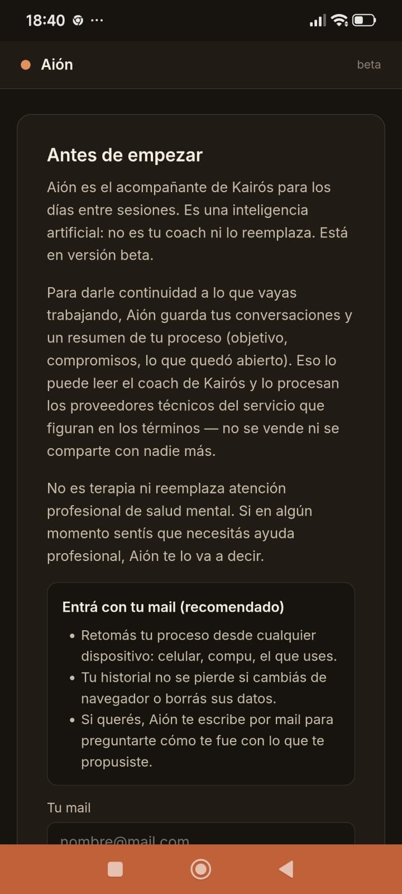
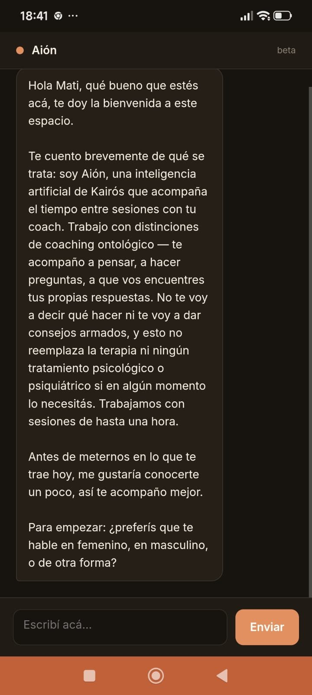

<div align="center">

# Aión

### An AI companion for the days between coaching sessions

Built on the Anthropic API · in production · closed beta

*This is a showcase repository. The source code and the coaching methodology are private; this page explains what Aión is, how it is used and how it was built.*

</div>

---

## What it is

A coaching process happens in sessions, but change happens in between: a conversation that didn't go as planned, a commitment that is harder than expected, a doubt at 11 p.m. Until now, the person was alone with that until the next session.

**Aión is a conversational assistant that accompanies people who are in a coaching process with [Kairós](#about-kairós), in those days between sessions.** It doesn't replace the coach: it is a space to practise, think and keep the process alive, and everything it does stays visible to the human coach.

It is built on the **Ontology of Language**, the framework of ontological coaching. Aión doesn't give advice or tell people what to do: it asks questions so the person can notice their own judgements, emotions and commitments, and find their own answers.

## How it is used

**1. The person starts with informed consent.** Before the first message, Aión explains what it is and what it isn't — an AI, not a coach, not therapy — what is stored and who can read it. The person accepts the terms explicitly and can sign in with their email (a one-time code, no password) to continue from any device.

**2. A conversation, not a chatbot.** Aión gets to know the person — how they prefer to be addressed, what they do, what brings them — and then works through questions. It explores the three domains ontological coaching looks at: language (what am I judging, what am I promising?), emotions (what am I feeling?) and the body (what do I notice in my body when I say this?). Each conversation ends with a concrete action or reflection for the week, never a verdict about the person.

**3. It remembers the process.** When a conversation ends, Aión summarises it into a **process memory**: the goal, the stage of the journey, commitments with their dates, recurring judgements, the emotional state and a note for the coach. In the next conversation it picks up what was left open — treating that memory as a hypothesis the person can correct, never as a truth about them.

**4. It follows up, with limits.** If the person took on a commitment and allowed it, Aión writes to ask how it went, by email or WhatsApp. At most once every three days, only during the day, never in the middle of a conversation, and stopping it takes a single step.

**5. The coach supervises everything.** A private panel shows the coach each person's conversations, process memory, open commitments and a brief "for your next session". Aión prepares the ground; the coach decides.

<table>
<tr>
<td></td>
<td></td>
</tr>
<tr>
<td align="center"><sub>Informed consent before starting</sub></td>
<td align="center"><sub>Aión introduces itself and its limits</sub></td>
</tr>
</table>

*The coach's panel isn't shown here: it contains real people's processes.*

---

## Safety and ethics by design

A coaching assistant talks with people about things that matter to them, so the limits were designed first, not added later.

- **Referral protocol that can't be switched off.** If there are signs of significant distress or risk, Aión names it, stops coaching that point and refers the person to professional or emergency help. No user instruction can override it, and the alert is recorded for the coach.
- **Never diagnoses.** It asks which emotion is present instead of naming it for the person, and it never infers states from anything outside the conversation.
- **Built against existing standards:** the AACOP code of ethics for ontological coaches, the ICF standards for AI coaching (identify as AI, distinguish from full coaching, escalate to a human) and Argentina's personal data protection law (informed consent; access, correction and deletion on request).
- **Adults only**, with a human always reviewing.
- **Secure sign-in** with one-time codes that expire in 10 minutes and attempt limits — no passwords to leak.

## How it works

```text
Person ──► web chat (installable app) or WhatsApp
              │
              ▼
     Cloudflare Worker ── builds each turn: identity and rules,
              │            knowledge base, process memory,
              │            recent conversation
              ▼
     Claude (Anthropic Messages API)
              │
              ▼
     Reply on the same channel

Every 30 minutes the Worker also closes idle conversations,
summarises them into the process memory and sends due follow-ups.
```

- **The prompt is built in layers**, each answering a different requirement: identity and role, knowledge base, conversation rules, referral protocol, framing of use, and process memory. That is what separates Aión from a generic motivational chatbot with a one-line instruction.
- **Each competency of the professional coaching model** (the seven AACOP competencies) is translated into a concrete conversation rule.
- **Tool use**: Aión records commitments and alerts the coach through tools the model can call.
- Prompt and knowledge base are cached; each turn carries the last 24 messages.
- Conversations and memory are stored in Cloudflare KV; credentials live as Cloudflare secrets, never in the code.
- Changes to the prompt are made from real conversations reviewed in the panel and from testers' feedback, not by trial and error on users.

## Tech stack

| | |
|---|---|
| **AI** | Claude via the Anthropic Messages API · tool use · prompt caching |
| **Backend** | Cloudflare Workers · Cloudflare KV · Cron Triggers |
| **Channels** | Installable web chat (PWA) · WhatsApp Cloud API |
| **Email** | One-time sign-in codes and follow-ups |

## About Kairós

Kairós is a coaching practice founded by Matías Roselló and Noelia Ferreyra. Aión was built by Matías, who is a certified ontological coach (AACOP) with a focus on neurocoaching — so the tool is written from inside the discipline, not from outside it.

---

<div align="center">

**Matías Roselló** · [GitHub](https://github.com/rikochet87) · rosellomatias87@gmail.com

</div>
